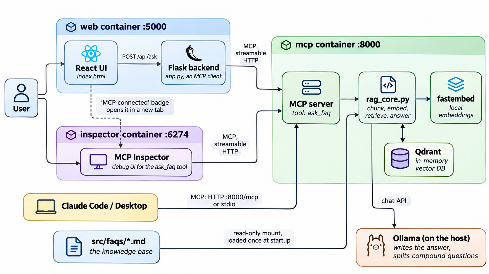

# FAQ RAG demo

A minimal RAG system that answers questions from the markdown files in `src/faqs/`. It runs entirely in Docker, with a local LLM through Ollama and no API keys. On macOS this guide uses [Colima](https://github.com/abiosoft/colima).

- **Vector DB:** the `qdrant-client` Python library, in memory (no Qdrant server)
- **Embeddings:** local, `fastembed` (`BAAI/bge-small-en-v1.5`), baked into the Docker image
- **Answers:** a model served by [Ollama](https://ollama.com), running on your machine
- **MCP server:** two tools, `ask_faq` and `list_models`. It owns the vector DB and is the only way to reach it
- **Web UI:** a static React page served by Flask. Flask talks to the MCP server like any other MCP client and never touches the DB
- **Loading:** the FAQ files are read, chunked and embedded once, when the MCP server starts



The MCP server is the only component that touches the vector DB, the FAQ files and Ollama. The web backend and Claude are both ordinary MCP clients of the same `ask_faq` tool.

## Prerequisites
- Docker CLI and Compose. Either `docker compose` (plugin) or the standalone `docker-compose` works. The commands below use `docker-compose`, so swap in `docker compose` if that is what you have
- macOS: Colima (`brew install colima docker docker-compose`)
- [Ollama](https://ollama.com) running on the same machine, with at least one model pulled (`ollama pull <model>`, check with `ollama list`)

## Run it

```bash
# 1. Start the container runtime (macOS / Colima). Skip this with Docker Desktop or Linux Docker.
colima start

# 2. Make sure Ollama is running and has the model named in src/.env
ollama list

# 3. Build and start (the first build downloads the embedding model, a few minutes)
docker-compose up --build
```

Open **http://localhost:5050**, type a question and press Ask.

Stop with `Ctrl+C`, or `docker-compose down` if you started it with `-d`. Stop the VM with `colima stop`. Docker Desktop works with the same commands, minus `colima start`.

## Configuration: `src/.env`
There are no secrets, so `src/.env` is a normal committed file that docker-compose loads into the `mcp` and `web` containers (`web` needs `CHAT_HISTORY_TURNS`). The two settings you will change are:

| Variable | Meaning |
|---|---|
| `OLLAMA_URL` | Where the container reaches Ollama. Default `http://host.docker.internal:11434` (the machine running Docker/Colima) |
| `OLLAMA_MODEL` | The model used for answers. Any model from `ollama list` |

Other optional variables, all with defaults in the code: `OLLAMA_TIMEOUT` (seconds, default 240), `EMBED_MODEL`, `CHUNK_SIZE` (max characters per chunk, default 1000), `CHUNK_OVERLAP` (only used when a long entry is split, default 100), `TOP_K_DEFAULT` (4), `CHAT_HISTORY_TURNS` (question/answer pairs remembered per chat to understand follow-ups, default 3, `0` turns memory off; see below), `MIN_SCORE` (minimum cosine similarity for a chunk to be used, default 0.60; see below) and `TEMPERATURE` (default 0). Compose itself sets `FAQ_DIR`, `MCP_TRANSPORT`, `MCP_HOST`, `MCP_PORT` and, for the web container, `MCP_URL`.

All variables are read in one place, `src/utils/__init__.py`, and the other modules import them from there (`from utils import OLLAMA_URL`). The same file validates them, so a bad value stops the container at startup with a clear message (visible in `docker-compose logs mcp`) instead of failing later. The rules: `OLLAMA_URL` and `MCP_URL` must start with `http://` or `https://`; `OLLAMA_MODEL` and `EMBED_MODEL` must not be empty; `OLLAMA_TIMEOUT` above 0; `TEMPERATURE` 0 to 2; `CHUNK_SIZE` at least 50; `CHUNK_OVERLAP` 0 up to below `CHUNK_SIZE`; `TOP_K_DEFAULT` 1 to 10; `CHAT_HISTORY_TURNS` 0 to 10; `MIN_SCORE` 0 to 1; `MCP_TRANSPORT` `stdio` or `streamable-http`; `MCP_PORT` 1 to 65535. A number that is not a number fails with Python's own error, such as `invalid literal for int()`. The FAQ directory is checked when the files are loaded (not at import, because the web container has no FAQ files).

After changing `src/.env`, recreate the container so it is re-read: `docker-compose up -d --force-recreate mcp web` (a plain `restart` does not reload it). Changing `EMBED_MODEL` also needs a rebuild, because the model is baked into the image: `docker-compose build --build-arg EMBED_MODEL=<name>`.

## Updating the FAQs
`src/faqs/` is mounted read-only into the `mcp` container and loaded once at startup. After adding, editing or deleting a file, reload with:

```bash
docker-compose restart mcp
```

The log (`docker-compose logs mcp`) shows one `[load] file#chunk id` line per chunk and a final `loaded N chunks from M files`.

## Inspect the MCP server
`docker-compose up` also starts the [MCP Inspector](https://github.com/modelcontextprotocol/inspector), a UI for listing the server's tools and calling them directly, without the web page or Claude. Open **http://localhost:6274**, or click the green **MCP connected ↗** badge in the web UI header, which opens it in a new tab. The badge is a link only while the web backend can reach the MCP server; otherwise it is a plain red or grey label. The Inspector is already pointed at the server (`http://mcp:8000/mcp`, Streamable HTTP), so connect to it and open the `ask_faq` tool (`question`, optional `top_k`).

The Inspector also prints a link with an access token in its log (`docker-compose logs inspector`), but you do not need it: the page served at `http://localhost:6274/` already carries the token.

It is published on `127.0.0.1` only. The Inspector warns that its token is not real access control, since the page hands the token to anyone who can load it, so don't expose port 6274 beyond your own machine. If you don't need it, delete the `inspector` service from `docker-compose.yml`, or start only the others with `docker-compose up mcp web`.

## Use it from Claude
The MCP server is exposed at **`http://localhost:8000/mcp`** (bound to localhost only, no authentication).

**Claude Code**
```bash
claude mcp add --transport http faq-rag http://localhost:8000/mcp
```
Then ask Claude something about the FAQs; it will call the `ask_faq` tool.

**Claude Desktop** (and any client that launches a local command): use stdio through the running container. Add to `claude_desktop_config.json`:
```json
{
  "mcpServers": {
    "faq-rag": {
      "command": "docker",
      "args": ["exec", "-i", "-e", "MCP_TRANSPORT=stdio", "faq-mcp", "python", "mcp_server.py"]
    }
  }
}
```
The `-e MCP_TRANSPORT=stdio` matters: the container is configured for HTTP, and this overrides it for this one process. The stack must already be running. Each stdio connection starts its own copy of the index, so allow a couple of seconds on first use.

**Tool contract:** `ask_faq(question: str, top_k: int = 4)` (`top_k` 1–10) also takes an optional `model` (an installed Ollama model; default `OLLAMA_MODEL`, an unknown one is an error) and an optional `history` (earlier `{"question", "answer"}` pairs, oldest first) and returns exactly `{"answer": "...", "sources": ["file.md", ...]}`.

## Project layout
```
Dockerfile, docker-compose.yml, .dockerignore
docs/
  system_architecture_diagram.png   shown by the web UI's "Architecture diagram" popup
src/
  .env                 configuration (Ollama endpoint and model, no secrets)
  requirements.txt
  app.py               Flask backend: an MCP client
  mcp_server.py        the ask_faq tool (stdio or streamable HTTP)
  frontend/index.html  React UI (React and Babel from a CDN, no build step)
  utils/
    __init__.py        every environment variable, read and validated in one place
    rag_core.py        chunking, IDs, embeddings, in-memory Qdrant, retrieval, answer
  faqs/                the knowledge base, mounted read-only into the mcp container
```
`docker-compose.yml` runs three services (`mcp` and `web` share one image):

| Service | Container | Command | Port | Notes |
|---|---|---|---|---|
| `mcp` | `faq-mcp` | `python mcp_server.py` | `127.0.0.1:8000` | Mounts `src/faqs` read-only and reads `src/.env` |
| `web` | `faq-web` | gunicorn `app:app` | `127.0.0.1:5050` | `MCP_URL=http://mcp:8000/mcp`. No FAQ files, no Ollama access |
| `inspector` | `faq-inspector` | `mcp-inspector --web` | `127.0.0.1:6274` | The official MCP Inspector image (`ghcr.io/modelcontextprotocol/inspector`, pinned to 2.14.0), pointed at `http://mcp:8000/mcp` |

## How it works

### Loading and deterministic IDs
At startup, each `*.md` file is read as UTF-8 and split into **one chunk per FAQ entry**, so every chunk holds a complete question and answer. The splitter understands the two formats used in `src/faqs/`: `Q: … / A: …` blocks, and `## Question` headings followed by the answer. The `# Title` line is not an entry and is dropped. An entry longer than `CHUNK_SIZE` (1000 characters) is split into overlapping windows, and a file with no entries at all falls back to fixed windows. All chunks are embedded in one batch and upserted into an in-memory Qdrant collection (cosine, 384 dims).

```
chunk_id = str(uuid5(NAMESPACE, f"{filename}:{chunk_index}"))
```
The same file name and chunk index always give the same ID, on every start and machine, so the logs and stored points are stable between runs. Qdrant needs a UUID or an integer ID, and `uuid5` is a SHA-1-based hash already in that format. Each point's payload holds `source`, `chunk_index` and `text`. The short ID in the logs is the first 8 characters.

### Answering a question
1. Validate `question` (non-empty) and `top_k` (1–10, otherwise 4).
2. If the chat has earlier turns (see [Chat memory](#chat-memory-follow-up-questions)), the model first rewrites the message into standalone questions, resolving references like "it" or "and for contractors?". Otherwise, if the question looks compound (it contains "and", "also", a comma, several question marks, …), ask the Ollama model to split it into separate questions, for example "how to request PTOs and reset my password" becomes "how to request PTOs" and "reset my password". Simple questions skip this step. One embedding of a two-topic question lands between the topics and retrieves neither well, so each part is searched on its own. If the split or rewrite fails, the question is searched as is, with a warning in the log.
3. Embed each question (`query_embed`) and take the top `top_k` chunks for it by cosine similarity from Qdrant, keeping only chunks that score at least `MIN_SCORE` (Qdrant's `score_threshold`). A chunk found by several sub-questions is kept once, so a compound question can use more than `top_k` chunks in total, and a weak match can leave fewer than `top_k`.
4. Join the retrieved chunks into the context (without filenames) and ask (with the rewritten question when there is history) the Ollama model (temperature 0 by default) to answer only from it: start with the direct answer, stay concise, answer every part of a multi-part question, never mention documents or files, and reply in Markdown. If the context has nothing relevant, the model must reply with a fixed message ("I couldn't find any information about that in the FAQs. Please try rephrasing your question."). For a multi-part question, a part that is not covered gets "I couldn't find information about … in the FAQs." The filenames are returned separately in `sources` and shown by the UI.
5. `sources` are the distinct filenames of the retrieved chunks, in rank order. With `top_k=1` and a simple question there is exactly one source. When the answer is the fixed "couldn't find" message, `sources` is empty.
6. If no chunk reaches `MIN_SCORE`, the fixed "couldn't find" message is returned straight away with no sources, **without calling the model** (about 0.05 s instead of 2 to 3 s). If nothing is loaded at all: `{"answer": "No FAQ content is loaded.", "sources": []}`.

**About `MIN_SCORE`.** The right value depends on the embedding model, because every model spreads its scores differently. With the default `BAAI/bge-small-en-v1.5` I measured the best match for 12 on-topic questions at 0.68 to 0.86, and for 9 unrelated questions at 0.48 to 0.58, so 0.60 sits in the gap with a bit more room on the on-topic side, since wrongly refusing a real question is worse than passing a weak match to the model. It cannot catch off-topic questions that share words with the FAQs: "What is the stock price of TechFlow today?" scores 0.77 because of the company name, and the model's own "couldn't find" fallback handles it. Re-measure and adjust `MIN_SCORE` if you change `EMBED_MODEL`. Set it to `0` to disable the cutoff.

At startup the server checks that Ollama is reachable and the model is pulled, and logs a warning with the fix if not. It never crashes for this, so the stack comes up and the web page shows a clear error until Ollama is ready.

### MCP server
- Transport from `MCP_TRANSPORT`: `stdio` (default, as `instructions.txt` requires) or `streamable-http` on `MCP_HOST:MCP_PORT`, endpoint `/mcp`.
- HTTP mode is stateless. The web backend opens a fresh client per request, and stateful sessions logged a long `ClosedResourceError` traceback for each one. Chat memory therefore lives in the web backend, not here.
- `ask_faq` sends progress notifications while it works (see [Progress steps](#progress-steps)).
- DNS-rebinding protection stays on, with an allowlist for `localhost`, `127.0.0.1` and `mcp`.
- All logging goes to stderr, since stdio uses stdout for the protocol.
- `mcp` is pinned `<2` in `src/requirements.txt`: mcp 2.x renamed `FastMCP` and would break the starter code.

### Web backend and UI
| Route | Behavior |
|---|---|
| `GET /` | the React page |
| `POST /api/ask` | `{"question", "top_k"?, "session_id"?}` → calls `ask_faq` through MCP → `{"answer", "sources"}`. With `"stream": true` the reply is newline-delimited JSON with a status line per step (see [Progress steps](#progress-steps)). `session_id` enables [chat memory](#chat-memory-follow-up-questions). The `top_k` sent by the UI's selector overrides `TOP_K_DEFAULT`; if it is missing or not a number the default is used, and a number outside 1–10 falls back to the default in the MCP tool. `400` for an empty question, `502` if the MCP call fails (with a readable message for "cannot reach Ollama" and "model not found") |
| `GET /api/health` | lists the MCP server's tools, `503` if unreachable |
| `GET /docs/<file>` | files from `docs/`, which the Dockerfile copies into the web image; the UI uses it for the architecture diagram. Paths that try to leave the folder return `404` |

The UI is a single `index.html` with React, `marked` and `DOMPurify` from a CDN (no build step, so it needs internet once for the scripts). It is a full-width, chat-style page: conversation history, clickable example questions on the empty state, a typing indicator with the current step, a collapsed **Steps** list under each answer, answers rendered from Markdown to sanitized HTML, source filenames as chips under each answer, a `top_k` selector, a Clear button (which also starts a new chat memory), and a badge that shows whether the backend can reach the MCP server. When it can, the badge reads "MCP connected ↗" and opens the MCP Inspector (port 6274 of the same host) in a new tab. An **Architecture diagram** button to the right of that badge opens a popup with `docs/system_architecture_diagram.png`; Esc, the ✕ button or a click outside the popup closes it, and "Open full size" shows the image in a new tab. The button works even when the MCP server is down. It follows the system light or dark theme and works on narrow screens.

### Choosing the Ollama model
`OLLAMA_MODEL` in `src/.env` stays the default. The page shows a model dropdown (next to `top k`) filled from `GET /api/models`, which calls the MCP tool `list_models` (returns `{"default": "...", "models": [...]}`: the models Ollama has pulled, minus names that look like embedding-only models). The choice is saved in the browser and sent as `model` with each question; picking the default sends nothing. `ask_faq` accepts only an installed model and returns a clear error for any other, rather than silently using the default. The same model is used for both model calls (the question rewrite and the answer); retrieval always uses the local embedding model, so it does not change. The first request with a model Ollama has not loaded yet is slower (`OLLAMA_TIMEOUT` applies). There is no authentication, so anyone who can open the page can run any installed model: fine on localhost, think twice before exposing it. The "Generating the answer with …" progress step shows which model is used.

### Chat memory (follow-up questions)

The web UI generates a random `session_id` when the page loads (and a new one when you click **Clear**) and sends it with every `/api/ask` request. The Flask backend keeps the last `CHAT_HISTORY_TURNS` question/answer pairs of each session in memory (sessions expire after 1 hour, at most 500 are kept; everything is lost on restart and not shared between workers) and passes them to the `ask_faq` tool as the optional `history` argument.

The history is used only to rewrite the question, not to answer it: when history exists, the model turns the latest message into standalone questions ("and for contractors?" becomes "How do I request PTO as a contractor?"), retrieval runs on those, and the answer is generated from the retrieved FAQ text only. Answers without sources (the "couldn't find" message) are not remembered. With history, every request makes the extra rewrite call to the model. Without a `session_id`, or with `CHAT_HISTORY_TURNS=0`, each question is independent, as before. The web container reads `src/.env` as well, because it owns the memory.

### Progress steps

`ask_faq` reports what it is doing with standard MCP notifications, so any client can show them, not only the web page: `notifications/progress` (a counter plus a message such as "Understanding the question", "Searching the FAQs", "Found 3 relevant chunks", "Generating the answer with <model>"; sent only when the client supplies a progress token) and `notifications/message` log entries with the same text. The tool's input and output are unchanged, and clients that ignore notifications are unaffected.

The web backend asks for them: `POST /api/ask` with `"stream": true` returns newline-delimited JSON (`application/x-ndjson`): `{"type":"status","text":...}` for each step, then `{"type":"result","answer":...,"sources":[...]}` or `{"type":"error","error":...}`. Without `stream` the endpoint returns plain JSON as before. The UI shows the latest step next to the typing indicator and keeps the full list under each answer as a collapsed **Steps** section. This needs `mcp>=1.10` (rebuild the image after pulling).

## Verification status
The checks below were made before chat memory and progress steps were added; those two features have not been run end to end yet.

Checked on Colima (aarch64) with Ollama running on the host:
- The image builds with the embedding model baked in, and `web` reaches the MCP server over HTTP and sees exactly one tool, `ask_faq`.
- A question asked through the web API returned a real answer from the Ollama model (`gemma4:e4b-mlx`) with its sources, so the full path `web → MCP → Qdrant → Ollama` works. The container reaches the host's Ollama through `host.docker.internal`.
- The same tool called over stdio (`docker exec -i -e MCP_TRANSPORT=stdio …`) returned a real answer and wrote only protocol messages to stdout.
- The MCP endpoint answered an `initialize` request from the host at `localhost:8000/mcp`.
- With the five FAQ files (609 entries: auth 123, SSO 115, employee handbook 128, shipping policies 118, customer support policies 125), the loader produced exactly one chunk per entry. Questions about password reset, account lockout, SAML certificate expiry, parental leave, PTO, equity vesting, shipping times and cost, countries served, warranty, returns and refunds, support hours and support plans each came back with the right answer and the right source file. With the earlier fixed 200-character windows, the plain "How do I reset my password?" question failed once the files grew to about 120 entries each, because the right chunk ranked 7th.

- Compound questions ("How do I request PTO and reset my password?") are split and both parts are answered. A question the FAQs cannot answer returns the fixed "couldn't find" message with no sources. Empty questions return `400`, and `top_k` values of `0`, `99` or `"abc"` fall back to 4 without an error.
- With `MIN_SCORE=0.60`, four unrelated questions returned the "couldn't find" message in 0.05 to 0.10 s with no model call, and five on-topic questions in varied wording were all still answered. Qdrant's local in-memory mode honours `score_threshold`.
- The FAQ content is consistent: no duplicate questions, and the numbers I cross-checked (password length, lockout, SSO session length, certificate validity, 401(k) match, holidays, parental leave, notice period) agree with each other.
- The Inspector UI and the web page both answer with HTTP 200, and the container logs show no errors.

**Known limitation (measured before `ask_faq` moved to a worker thread to send progress notifications; not re-measured since):** the `ask_faq` tool ran synchronously, so while one answer was being generated the server handled other requests, including the health check behind the "MCP connected" badge, only after it finished. In a test the health check waited about 2 seconds during a 4-second answer. With a much slower model the badge could briefly have shown "MCP unreachable".

## Troubleshooting
- **`error getting credentials … docker-credential-desktop: executable file not found`** (during `docker-compose up --build` with Colima): your `~/.docker/config.json` still points at Docker Desktop's credential helper. Delete the line `"credsStore": "desktop"` from that file.
- **`Cannot add MCP server "faq-rag": not allowed by enterprise policy`** (from `claude mcp add`): your organization restricts which MCP servers Claude Code may use. This is not a fault in the server. Ask your admin to allow a local server named `faq-rag` at `http://localhost:8000/mcp` (or the stdio command from the Claude Desktop section). Run `/mcp` in Claude Code to see what is configured. Meanwhile the web UI and the MCP Inspector (`npx @modelcontextprotocol/inspector`, pointed at `http://localhost:8000/mcp`) exercise the same tool.
- **`docker: unknown command: docker compose`**: you only have the standalone binary. Use `docker-compose` (with a hyphen).
- **`Cannot connect to the Docker daemon`**: the runtime is not running. Run `colima start` (or start Docker Desktop).
- **The web page says it could not reach Ollama**: check that Ollama is running (`ollama list`) and that `OLLAMA_URL` works from inside the container: `docker exec faq-mcp python -c "import urllib.request,os; print(urllib.request.urlopen(os.environ['OLLAMA_URL']).read())"` should print `b'Ollama is running'`. If Ollama only listens on localhost on your platform, start it with `OLLAMA_HOST=0.0.0.0`. On a Linux host, `host.docker.internal` may not exist; use the host's IP in `OLLAMA_URL`.
- **The web page says the model was not found**: run `ollama pull <model>` for the `OLLAMA_MODEL` in `src/.env`.
- **The web page says it could not reach the MCP server**: the `mcp` container is down or still starting. Check `docker-compose logs mcp`.
- **FAQ changes are not showing up**: the files are loaded only at startup. Run `docker-compose restart mcp`.
- **Port already in use**: change the left-hand side of `127.0.0.1:5050:5050` or `127.0.0.1:8000:8000` in `docker-compose.yml`.
- **After changing `src/**/*.py`, `src/frontend` or `docs/`** (for example a new architecture diagram): rebuild with `docker-compose up --build`. The code and `docs/` are copied into the image, and only `src/faqs/` is mounted.
